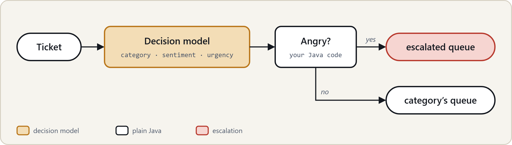
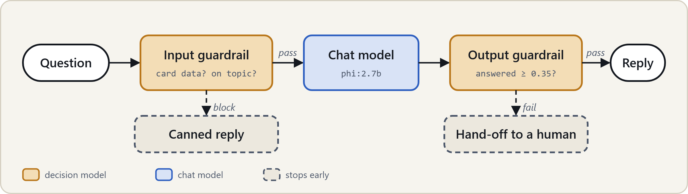

# Spring AI Decision Models


Customer support for an online musical instrument store, built on Spring AI's **decision model**
API and running entirely on local models through [Ollama](https://ollama.com).

A chat model writes text. A decision model answers a fixed question (yes or no, one of a
list, a point on a scale) and gives you a **probability for every possible answer**. Ask it
which team should handle a ticket:

```text
"The digital piano I bought doesn't work and the box was crushed in shipping."

technical  ████████████████████  0.64
shipping   ███████               0.21
returns    ████                  0.12
other      █                     0.03
billing                          0.00
account                          0.00
```

The top answer routes the ticket, and the runners-up show that it touches shipping and
returns too. Your code decides with plain Java, using thresholds you choose.

## Contents

- [What's inside](#whats-inside)
- [Quick start](#quick-start)
- [Ticket endpoints](#ticket-endpoints)
- [Support chat with guardrails](#support-chat-with-guardrails)
- [Reading the answers](#reading-the-answers)
- [Configuration](#configuration)
- [Postman](#postman)
- [Tests](#tests)
- [Troubleshooting](#troubleshooting)
- [License](#license)

## What's inside

The decision model does two jobs:

- **Ticket classification**: is a message on topic, which team should handle it, how the
  customer feels, how urgent it is, and which queue it goes to.
- **Chat guardrails**: it checks a support chatbot's input before the chat model runs, and its
  reply before the customer sees it.

## Quick start

You need Java 25 and [Ollama](https://ollama.com), running at `http://localhost:11434`.

```bash
./gradlew bootRun
```

Missing models are downloaded on first startup, so the first run takes a while. The app listens
on port 8080. Ask it something:

```bash
curl -X POST "http://localhost:8080/tickets/category" \
  -H "Content-Type: text/plain" \
  --data "The neck of my new guitar is cracked. Can I get my money back?"
```

```json
{
  "value": "returns",
  "probability": 0.929,
  "probabilities": { "billing": 0.008, "shipping": 0.0003, "returns": 0.929, "technical": 0.029, "account": 0.0002, "other": 0.034 },
  "rankedOptions": ["returns", "other", "technical", "billing", "shipping", "account"],
  "confidence": 0.915
}
```

Example outputs in this README come from `d1-omni:600m`. Other decision models give different
probabilities.

## Ticket endpoints

All are `POST`. The single-text endpoints take the message as a plain-text body, and triage
takes JSON. A blank message, or a ticket without a subject or body, gets a `400`.

| Endpoint | Body | Returns |
|---|---|---|
| `/tickets/on-topic` | the message, as text | Yes/no answer with its probability |
| `/tickets/on-topic/threshold` | the message, as text; `?threshold=` (default `0.5`) | `true` / `false` |
| `/tickets/category` | the message, as text | Chosen team, with a probability per option |
| `/tickets/sentiment` | the message, as text | Score from angry (0) to happy (3), with a probability per level |
| `/tickets/triage` | JSON: `subject`, `body`, `customer` (default `individual`) | Queue, category, sentiment and urgency |

Triage asks three questions in a single model call, then routes in plain Java: angry customers
go to the `escalated` queue, everyone else to their category's queue.



```json
{ "queue": "escalated", "category": "billing", "sentiment": "angry", "urgency": "high" }
```

## Support chat with guardrails

`POST /support/chat` takes the question as a plain-text body and returns the answer as text. The
assistant answers only from a short store policy covering shipping, returns and refunds.

```bash
curl -X POST "http://localhost:8080/support/chat" \
  -H "Content-Type: text/plain" \
  --data "How long do I have to return a guitar?"
```

Two Spring AI advisors wrap the chat model, and both ask the decision model:



| Guardrail | Runs | Asks | When it fails |
|---|---|---|---|
| **Input** | before the chat model | Does the message contain payment or ID numbers? Is it about the store? | A canned reply; the chat model is never called. |
| **Output** | after the chat model | Does the reply actually answer the question? | The reply becomes a hand-off to a human agent. |

Both **fail closed**: if the decision model refuses to answer, the check counts as failed.

## Reading the answers

- **Probabilities** are what the model assigned to each answer. Put your thresholds on these.
- **Confidence** is Ollama's own estimate, not the probability of being right.
- **Score levels** are numbered in declaration order. Act on `nearestLevel` (the most likely
  level), not `roundedLevel` (the rounded average, which can land on a level the model barely
  chose).

## Configuration

| Component | Version or setting |
|---|---|
| Java | 25 |
| Spring Boot | 4.2.0 |
| Spring AI | 2.1.0 |
| Decision model | `d1-omni:600m`, set by `spring.ai.ollama.decision.model` |
| Chat model | `phi:2.7b` at temperature 0, set by `spring.ai.ollama.chat.model` |

To try another decision model without editing `application.yml`:

```bash
./gradlew bootRun --args="--spring.ai.ollama.decision.model=d3:2b"
```

## Postman

Every request is in a Postman collection, ready to send: in Postman, click **Import** and drop in
`postman/Spring AI Decision Models.postman_collection.json`. Its `baseUrl` variable defaults to
`http://localhost:8080`.

## Tests

```bash
./gradlew test
```

`TicketControllerTest` stubs the decision model and runs without Ollama.
`DecisionModelsApplicationTests` starts the whole application, so it needs Ollama running.

## Troubleshooting

**Startup fails with `Connection refused`.** The app checks Ollama while it starts, so start
Ollama first. If the error shows `localhost/<some IP>:11434` and the IP isn't `127.0.0.1`, your
hosts file maps `localhost` somewhere else: remove that entry.

## License

[MIT](LICENSE)
